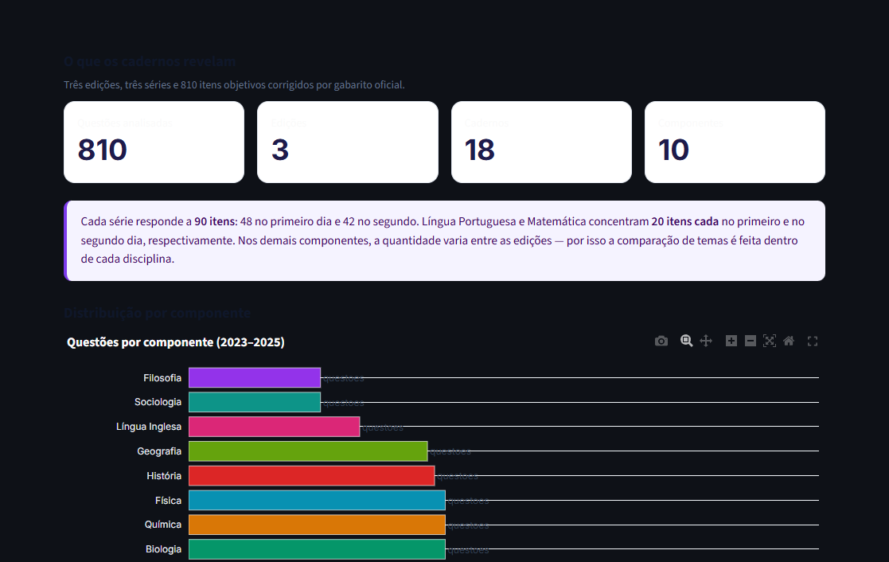
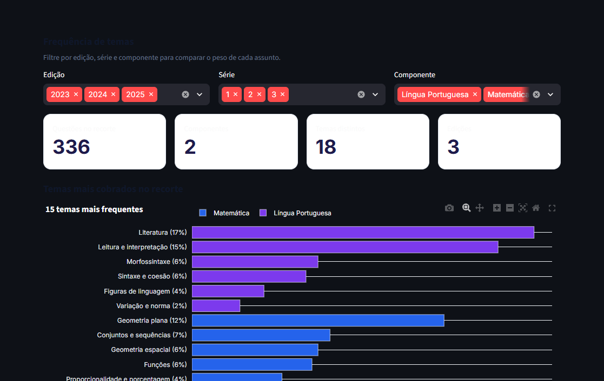
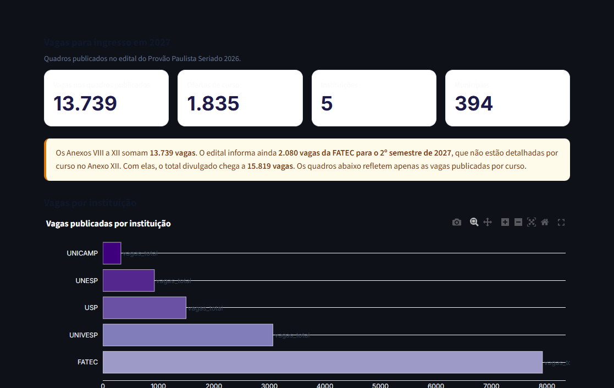

# Provão em Foco

Painel para consultar o que mais cai no **Provão Paulista Seriado**, comparar a frequência dos temas entre edições e séries e ver as vagas oferecidas pelas universidades públicas paulistas para o ingresso em 2027.

O projeto reúne os cadernos de **2023, 2024 e 2025**, os gabaritos oficiais e os quadros de vagas do edital de 2026. Todo o conteúdo do painel está em português.



## O que o painel responde

- Quais temas aparecem com mais frequência em cada componente.
- Como os temas se distribuem entre a 1ª, a 2ª e a 3ª série.
- Quais questões caíram em cada edição, com gabarito, classificação e link para o caderno.
- Como é a estrutura de um simulado com questões reais.
- Quais cursos, campi e municípios oferecem vagas para 2027.
- Como os dados foram extraídos, classificados e conferidos.

## Números do projeto

| Item | Total |
| --- | ---: |
| Edições analisadas | 3 (2023, 2024 e 2025) |
| Séries | 3 |
| Questões extraídas | 810 |
| Questões com gabarito preenchido | 810 |
| Componentes curriculares | 10 |
| Questões com alternativas em texto | 783 |
| Questões com alternativas apenas em imagem | 27 |
| Ofertas de curso para 2027 | 1.835 |
| Vagas publicadas por curso | 13.739 |
| Vagas divulgadas no edital | 15.819 |
| Instituições | 5 |
| Municípios com oferta | 394 |
| Questões inéditas autorais | 22 |

As **13.739 vagas** são as que aparecem detalhadas por curso nos Anexos VIII a XII. O edital informa ainda **2.080 vagas da FATEC para o 2º semestre de 2027**, que não estão discriminadas por curso no Anexo XII. Somadas, chegam às **15.819 vagas** divulgadas. O painel separa esses dois números para não dar a entender que todas as vagas já estão disponíveis para escolha.

## Abas

**Panorama** — visão geral da composição dos cadernos, distribuição por componente e temas mais frequentes.

**Temas** — filtros por edição, série e componente, ranking dos temas e evolução ano a ano. Quando um único componente é selecionado, o painel mostra o peso relativo de cada tema dentro dele.

**Banco de questões** — todos os 810 itens, com enunciado, alternativas, gabarito, tema e página do caderno. A busca textual e os filtros permitem montar recortes; o resultado pode ser baixado em CSV.

**Simulado** — sorteio de questões reais com correção automática, aproveitamento e tabela de acertos por tema.

**Questões inéditas** — 22 questões autorais escritas a partir dos temas recorrentes, com resolução comentada.

**Vagas 2027** — totais por instituição, área e município, comparativo com as edições anteriores e consulta por curso, campus, turno e cidade.

**Método e fontes** — decisões de extração, classificação, limitações e links para os documentos oficiais.





## Como rodar

Requisitos: Python 3.11 ou superior.

```powershell
python -m venv .venv
.\.venv\Scripts\activate
pip install -r requirements.txt
streamlit run app.py
```

No Linux ou macOS, a ativação é `source .venv/bin/activate`.

O painel abre em `http://localhost:8501`.

### Testes e verificação de estilo

```powershell
pip install -r requirements-dev.txt
python -m pytest
ruff check .
```

A suíte cobre a extração, a taxonomia, o quadro de vagas e as questões inéditas. Os testes conferem, entre outros pontos, as 810 questões, os 90 itens por série em cada edição, os totais de vagas por instituição e a consistência dos arquivos processados.

## Como os dados foram construídos

### Cadernos e gabaritos

Os cadernos e os gabaritos foram baixados do site oficial do Provão Paulista Seriado, mantido pela Vunesp. Cada edição tem dois dias de prova e 90 itens por série: 48 no primeiro dia e 42 no segundo.

Os PDFs usam layout em duas colunas. A extração respeita a ordem das colunas; uma leitura linear embaralharia enunciados, alternativas e textos de apoio. Os gabaritos foram vinculados item a item e conferidos contra os arquivos oficiais.

### Classificação dos temas

A taxonomia parte do conteúdo programático do Anexo VII do edital. A classificação usa regras de palavras-chave no enunciado e, quando necessário, nas alternativas. Casos ambíguos foram revisados manualmente em `data/reference/temas_manuais.json`.

Como toda classificação automática, os totais são uma aproximação. Eles servem para orientar o estudo e comparar recorrências, não para substituir a leitura do programa oficial.

### Vagas

As vagas vêm dos Anexos VIII a XII do edital de 2026, que organiza o ingresso em 2027. O parser reconstrói cada registro a partir do texto do PDF, trata municípios e turnos que ocupam mais de uma linha e unifica grafias do mesmo município. Os totais são validados contra os números publicados no próprio edital:

| Instituição | Vagas publicadas |
| --- | ---: |
| USP | 1.500 |
| UNESP | 929 |
| UNICAMP | 326 |
| UNIVESP | 3.064 |
| FATEC | 7.920 |
| **Total** | **13.739** |

A UNIVESP oferece vagas no 2º semestre de 2027. As demais instituições, no 1º semestre.

### Vagas ao longo das edições

O painel compara o total divulgado nos quatro editais. Os números seguem o dispositivo que abre a seção de vagas de cada edição e somam os dois semestres de ingresso; não são a soma dos quadros por curso, porque parte das vagas da FATEC é publicada apenas como total semestral.

| Edição | Ingresso | USP | UNESP | UNICAMP | UNIVESP | FATEC | Total |
| --- | ---: | ---: | ---: | ---: | ---: | ---: | ---: |
| 2023 | 2024 | 1.500 | 934 | 325 | 2.610 | 10.000 | **15.369** |
| 2024 | 2025 | 1.490 | 934 | 325 | 2.631 | 10.000 | **15.380** |
| 2025 | 2026 | 1.500 | 934 | 327 | 2.956 | 10.000 | **15.717** |
| 2026 | 2027 | 1.500 | 929 | 326 | 3.064 | 10.000 | **15.819** |

Entre 2023 e 2026, o total cresceu 450 vagas (+2,9%). A UNIVESP respondeu por quase todo o acréscimo (+454 vagas); as demais instituições ficaram praticamente estáveis.

### Limitações

- **27 questões** têm alternativas apenas em imagem. Elas permanecem no banco, com a indicação da página do caderno, mas não entram no simulado.
- Em 2024 e 2025, Filosofia e Sociologia se alternam entre as séries; em 2023, as duas aparecem na mesma edição. Por isso a tabela de componentes por edição tem 86 combinações, e não 90.
- As 2.080 vagas da FATEC para o 2º semestre de 2027 não estão detalhadas por curso no Anexo XII.
- Localidades da capital paulista (Butantã, Ipiranga, Itaquera e outras) foram agrupadas no município de São Paulo para permitir a contagem por cidade.

## Regerar as bases

Os PDFs e o edital não são versionados. Para reconstruir os arquivos processados, coloque os originais em `data/raw`:

```text
data/raw/
├── 2023/
│   ├── 2023-1a-lc-cn.pdf
│   ├── 2023-1a-mt-ch.pdf
│   ├── 2023-1a-gab-d1.pdf
│   └── ...
├── 2024/
├── 2025/
└── 2026/
    └── edital.txt
```

Depois execute:

```powershell
python scripts/build_dataset.py
python scripts/build_vagas.py
```

O primeiro comando gera `questoes.csv.gz`, `contextos.csv.gz`, `temas.csv.gz` e `disciplinas.csv.gz`. O segundo gera `vagas_2027.csv.gz`. Os arquivos ficam em `data/processed` e são a base usada pelo aplicativo e pelos testes.

## Estrutura

```text
app.py                     ponto de entrada do Streamlit
src/provao/
├── app.py                 abas e visualizações
├── dados.py               carga e construção das bases processadas
├── extracao.py            leitura dos cadernos e dos gabaritos
├── taxonomia.py           regras de classificação dos temas
├── vagas.py               leitura dos quadros de vagas do edital
├── ineditas.py            carga das questões autorais
└── ui.py                  componentes visuais e formatação
scripts/                   rotinas de construção e diagnósticos
tests/                     testes automatizados
data/processed/            bases derivadas, versionadas em gzip
data/reference/            taxonomia, questões inéditas e textos de apoio
docs/screenshots/          imagens usadas neste README
```

## Fontes

- [Provão Paulista Seriado — cadernos e gabaritos](https://provaopaulistaseriado.vunesp.com.br/)
- [Edital 10/2026 e Anexos — Vunesp](https://www.vunesp.com.br/SEED2602)
- [Secretaria da Educação do Estado de São Paulo](https://www.educacao.sp.gov.br/)

## Autor

Henrique Sakita — [LinkedIn](https://www.linkedin.com/in/henrique-sakita/)

Código sob licença MIT.
